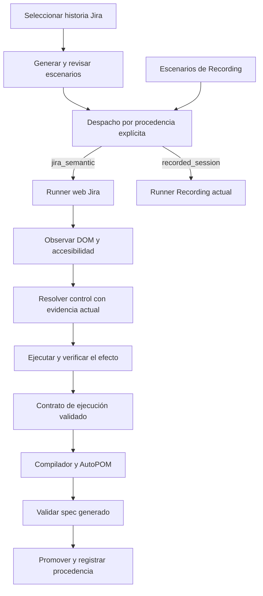

# Plan: motor web para escenarios generados desde Jira

Fecha: 2026-10-09. Estado: primera implementación web en validación local.

## Objetivo y alcance

Ejecutar escenarios derivados de una historia Jira sin requerir grabación previa ni objetos capturados por el usuario. El motor descubre los controles durante la ejecución, valida el comportamiento esperado y produce un contrato ejecutable que permite generar, verificar y promover un spec con POM.

Crear un runner y una política de ejecución propios para esta modalidad. Mantener el comportamiento actual de Recording, su derivación, sus contratos y su replay. La separación se hace por procedencia explícita del escenario, no por nombre de proyecto. Todos los proyectos web usan las mismas reglas; URL, datos y capacidades provienen del perfil del proyecto.

Este plan cubre web. La implementación de motores móviles y API queda fuera de este alcance.

## Evidencia de los logs y del código actual

Los adjuntos del usuario corresponden a la generación desde Jira AA-88 y la ejecución de seis escenarios de Kiosko, TestRail run 4613. El resultado fue 0/6 aprobados. No todos los fallos tienen la misma causa:

1. Generación reporta `needs_route_profile` y luego un perfil inferido a partir de escenarios. Un perfil inferido no demuestra la existencia de controles ni rutas en la aplicación.
2. El runner reconoce `recordingReplay=false`, pero aplica preparación y normalización dentro del mismo runner que maneja Recording. La inserción de entrada se rechaza con `canonical_authority_missing`.
3. `scenario-detail-guard` inserta “Seleccionar el primer elemento visible del listado” en escenarios que incluyen una observación de autenticación. Esa acción no forma parte de la intención original mostrada y no constituye una identidad técnica suficiente.
4. PREVIEW-002 alcanza `/client-identification`, pero termina en `auth_timeout_with_progress`. Un escenario que exige llegar a autenticación necesita observar el gate; no necesariamente completarlo.
5. PREVIEW-003/004/005 reportan `deterministic_unsupported_capabilities` con `operation_unsupported:assertVisible`, `requiredActions=0` y `compiledActionBindings=0`. Hay una pérdida en el transporte a compilación que debe reproducirse con esos contratos concretos; no demuestra que todas las assertions estén sin soporte.
6. PREVIEW-006 incluye búsqueda literal de “pantalla de autenticación del kiosco para iniciar sesión”; ese requisito semántico no demuestra que exista ese texto literal en el DOM.
7. El cálculo de elegibilidad en `src/cli/discovery-preview.ts` usa `recordingReplay && discoveryPassed`, y reporta `not_recording_replay` para Jira. Es una restricción de clasificación que debe separarse en la nueva modalidad; no explica por sí sola los fallos funcionales anteriores.
8. El log del proxy muestra primero escenarios AA-82 y después AA-88. Las solicitudes pueden ser distintas: no está probado que se mezclaran en un mismo job. El nuevo contrato debe verificar issue, escenario y revisión en todas las fronteras.

Puntos actuales de integración: `src/server/routes/runs.ts`, `src/server/jobs/scenario-preview-runner.ts`, `src/cli/discovery-preview.ts`, `src/types/scenario-preview.types.ts`, `src/automations/spec-execution-contract.ts` y el compilador determinista. En QA Lab: `C:/MisProyectos/QA-lab-main/src/pages/TestLaunch/index.tsx`, su proveedor y `server/routes/runs.ts`. Hoy el frontend publica casos/crea TestRail Run y luego solicita el job; preservar sus correlaciones sin duplicar publicaciones.

## Arquitectura propuesta

Los contratos descritos a continuación se implementaron de forma inicial en `src/jira`, el runner dedicado, los despachadores y el adaptador a promoción. Las restricciones conocidas se indican en el resumen de estado al final de este documento.

### Despacho explícito

Añadir una procedencia versionada, por ejemplo `scenarioOrigin.kind = jira_generated | recorded_session`, y una política `executionEngine = jira_semantic | recording_replay`. El backend valida y decide el despacho; el frontend transporta procedencia, sin poder convertir una grabación incompleta en un escenario Jira.

Seleccionar historia → generar escenarios → revisión y selección → iniciar ejecución. La generación devuelve la procedencia y conserva el Jira key, requisitos y versión. Al crear el job se valida ese contrato y se despacha al runner Jira. Abrir la pantalla o generar escenarios no ejecuta navegadores ni publica resultados.

Casos legacy: una grabación con identidad y contrato válidos conserva el despacho actual. Una grabación inválida queda bloqueada con motivo explícito. Una solicitud Jira debe acreditar su historia y escenario; la ausencia de `recordingId` no basta. Un payload contradictorio o de origen desconocido queda rechazado. El rerun conserva la modalidad del job original.

Un spec promovido compatible puede reutilizarse con su hash, linaje, proyecto y procedencia. Rediscovery debe ser una elección explícita. Registrar versión del motor como trazabilidad; definir compatibilidad, sin invalidar todos los specs por cualquier cambio de versión.

### Entrada del motor Jira

Contrato inmutable `JiraWebExecutionRequest` con:

- Proyecto web: `appSlug`, perfil resuelto desde la configuración/SQL actual, URL base y política de navegación.
- Procedencia: Jira key, revisión de la historia, scenarioId estable, revisión/hash de escenario, requestId y engineVersion.
- Pasos semánticos tipados: acción, objetivo, contexto de campo/fila, dato mediante `valueKey`, resultado esperado, requisito de origen y orden original.
- Precondiciones, requisitos de datos, assertion de cada paso y criterio final del caso.
- Intención de autenticación: observar el gate o realizar autenticación completa.
- Correlación con launchId, TestRail run y caseId cuando ya existen; opciones de generación/promoción autorizadas.

Las frases originales se conservan para auditoría. Normalizar su forma no autoriza añadir clicks, cambiar el resultado esperado o eliminar verificaciones. Separar readiness semántica, disponibilidad de datos y certificación técnica: una HU válida puede requerir Discovery en vivo sin tener locators previamente capturados.

## Componentes necesarios

| Componente propuesto | Responsabilidad y condición de aceptación |
|---|---|
| `JiraScenarioAdmission` | Verificar procedencia, proyecto, datos requeridos y pasos; rechazar contradicciones con motivo verificable. |
| `JiraStepPlanner` | Interpretar click/fill/select/press/check/assert y mantener relación 1:1 con los requisitos originales. Distinguir condición semántica de texto literal. |
| `WebObservationPort` | Obtener DOM/accesibilidad, controles visibles, etiquetas, estados, contenedores, rutas, loading y red; eliminar valores sensibles. |
| `JiraTargetResolutionPolicy` | Resolver el objetivo contra candidatos observados usando las utilidades existentes aptas para DOM vivo, con scope de campo/fila y unicidad. |
| `JiraWebExecutionRunner` | Ejecutar el ciclo observar → resolver → actuar → verificar, con estados y presupuestos por paso y por caso. |
| `JiraAssertionEvaluator` | Verificar texto explícito, visibilidad, URL, estados y gates semánticos con señales observadas y requisito vinculado. |
| `JiraExecutionContractBuilder` | Materializar locators, acciones, bindings y assertions demostrados para compilador/AutoPOM sin fabricar evidencia de Recording. |
| `JiraJobReporter` | Emitir eventos Live de QA Lab, evidencia y resultados de cada fase con identidad estable y paso real. |

Separar orquestación y políticas; reutilizar utilidades probadas mediante interfaces. Evitar copiar el gran runner actual o crear un segundo algoritmo genérico de resolución. Si una utilidad está acoplada a Recording, crear el adaptador de Jira o proponer una extracción pequeña con pruebas de compatibilidad, antes de modificar la rama de grabación.

### Transporte MCP / navegador

En los módulos inspeccionados la sesión se controla mediante Playwright y se trabaja con snapshots; el nombre MCP no prueba que ese recorrido utilice un servidor MCP externo. El motor necesita un puerto de navegador explícito. La primera implementación puede usar el transporte Playwright existente. Si el requisito de implementación incluye Playwright MCP, añadir su adaptador, comprobar herramientas disponibles, errores, cancelación y aislamiento, y mantener el mismo contrato de observación/acción. No asumir herramientas o SDKs instalados.

Referencias de un snapshot MCP son temporales: sirven para actuar en esa observación, no para guardarlas como selector duradero en un spec. Convertirlas a identidad comprobada en DOM; volver a observar tras cada transición.

### Resolución sin objetos grabados

1. Abrir el perfil y capturar el estado actual antes del primer paso.
2. Buscar candidatos por rol/nombre accesible, label y relación de campo, identificadores estables y contenedor. Los candidatos deben existir en esa captura.
3. Comprobar unicidad, visibilidad, estado enabled/editable y compatibilidad con la operación. No seleccionar por índice como sustituto de identidad.
4. Si hace falta interpretación semántica, el proveedor configurado puede elegir un candidateId real del snapshot. Sus salidas se validan y la propuesta se vuelve a comprobar en el DOM. La IA no certifica un selector inventado.
5. Si la página cambia, descartar refs temporales y observar de nuevo. Si hay ambigüedad o falta de datos, detener el caso con evidencia.

Un routeProfile existente puede ayudar a orientar navegación y aliases; no es obligatorio para todos los casos Jira ni autoriza un control no observado. Si el caso exige una ruta previa que ni el escenario ni el perfil permiten determinar, reportar precondición faltante. Exploración adicional solo como setup explícito, acotado y trazable, sin alterar el paso a paso funcional.

### Ejecución y assertions

- Esperar por señales reales de UI, red, navegación y progreso con presupuesto máximo. Evitar sleeps fijos.
- Distinguir click despachado de efecto observado. Verificar selección/readback, fill, transición, descarga o resultado requerido.
- Listas: abrir el control asociado, buscar la opción por valor/identidad y verificar readback. Recuperaciones condicionales requieren controles reales, scope de la lista, límite y comprobación de carga.
- Autenticación: `gate_observation` comprueba que apareció el gate y termina ese requisito. `full_authentication` necesita datos y flujo configurado. Un teclado virtual solo se utiliza cuando lo demuestra el DOM.
- Assertion semántica: “pantalla de autenticación” debe resolverse a un gate observado y una comprobación concreta. No convertir automáticamente cada descripción en `getByText`.
- Assertions negativas y escenarios de fallos de red necesitan una condición reproducible, definida por el escenario/fixture; no marcar aprobado un error que no se provocó ni observó.
- Cada caso usa contexto y datos aislados. Reinicializar sesión por escenario salvo dependencia expresamente declarada; no reutilizar URL, cache ni variables de otro proyecto.
- Reintentos: acotados por clase de error. No repetir una transferencia/submit solo porque faltó una confirmación; verificar el estado antes de repetir acciones con efectos.
- Un fallo termina ese escenario y permite continuar con los demás. Cancelación libera su browser y procesos.

## Salida, compilación y promoción

Crear `JiraDiscoveredExecutionContract` versionado con pasos de origen, locators/identidad verificados, resolución y evidencia por paso, datos por key, assertions con mecanismo concreto y efectos observados. Distinguir `jira_step` de `discovery_observation`; nunca etiquetar evidencia viva como grabada.

Un adaptador lo convierte al `SpecExecutionContract` común. Debe comprobarse que assertions de visibilidad, estado, URL y autenticación conservan su soporte al cruzar builder → contrato → compilador → runtime. Las incompatibilidades bloquean la promoción y reportan el paso/requisito exactos.

Reutilizar compilador y AutoPOM mediante su contrato público. Los ajustes compartidos se aíslan y se prueban también con contratos de Recording. Si no es posible sin alterar el comportamiento de Recording, detener esa fase y documentar la dependencia antes de cambiarla.

Promover únicamente cuando: todos los pasos requeridos y criterios esperados estén cubiertos; el contrato sea compilable; estructura/TypeScript/discovery del spec pasen; POM y bindings sean válidos; ejecución funcional del candidato pase. La mera visibilidad de controles o un porcentaje de cobertura no bastan. Un escenario de solo assertions también puede ser válido: no requerir un click artificial para promoverlo.

Guardar candidatos bajo el job y distinguir sus identidades de los specs existentes. Namespace y registro deben distinguir proyecto, Jira key y scenarioId estable, sin usar solamente `PREVIEW-001`. Conservar specs anteriores y hashes; no sobreescribir automáticamente los de Recording. Las credenciales se resuelven en runtime y no se escriben como literales ni aparecen en texto de pasos, snapshots, screenshots, logs o informes.

## Integración y experiencia en QA Lab

Mantener los módulos Lanzar pruebas, selección de Jira y Live Execution. Añadir modalidad/procedencia en generación, lanzamiento, proxy y backend. Mostrar fases: preparando → descubriendo → ejecutando → generando spec → AutoPOM → validando spec → promovido/fallido/bloqueado. Mostrar por caso proyecto, historia, escenario, paso actual y motivo con captura cuando falle.

Preservar eventos actuales y añadir campos versionados: engine, engineVersion, scenarioId, originalStepIndex, phase, reasonCode y evidenceRef. Contadores de ejecutados, aprobados y promovidos separados; `passed` no implica `promoted`.

Preservar mapeo scenarioId ↔ TestRail caseId, permisos y acceso al proyecto en los endpoints. Añadir idempotencia al lanzamiento para que un reintento de red no cree dos jobs o publicaciones. Rechazar mezclas contradictorias; si se permite un batch mixto, despachar cada escenario con su motor y agregar resultados sin perder identidad.

## Fases de implementación

1. **Contrato y despacho.** Implementado con tests de procedencia Jira/legacy/Recording y rechazo de mezclas; modo viaja desde generación a job/rerun.
2. **Primer recorrido vertical.** Implementado con navegador Playwright dedicado y fixture local multi perfil.
3. **Interacciones y datos.** Fill, click, press, selección native/custom y gate auth tienen cobertura inicial. Pendiente: selección por checkbox, listas dependientes/recuperación, teclado virtual, ventanas/frames, descargas, rutas/setup compuestas y autenticación completa. Capacidades no soportadas se rechazan explícitamente.
4. **Spec y AutoPOM.** La promoción determinista con ejecución funcional y AutoPOM pasa en fixture local; el test también verifica el spec generado. Pendiente validación en app real y preservación del spec existente de extremo a extremo en rerun Jira.
5. **QA Lab y resultados.** Despacho frontend/backend, eventos por caso/paso, datos agrupados por escenario, rerun, cancelación, publicación opcional al TestRail Run ya creado y continuación por fallo implementados inicialmente. Pendiente job vivo autorizado y telemetría real en QA Lab.

### Estado de implementación y límites conocidos

- La ruta nueva solo se usa con `executionEngine=jira_semantic`, procedencia Jira válida e historias con IDs únicos. La ruta legacy y Recording mantienen su despacho por defecto.
- Los artifacts Jira usan sección aislada `jira-<issue-key>` por app para separar su identidad de los specs de Recording. Antes de overwrite se guarda copia del caso bajo artifacts del job.
- El runner se ejecuta en Playwright mediante el browser port, no sobre un servidor MCP externo. No se afirma compatibilidad MCP sin verificar el transporte instalado.
- Negaciones, precondiciones no ejecutadas, autenticación completa implícita, rutas de navegación sin perfil, interacción condicional/selección por ordinal y aserciones semánticas sin oracle soportado bloquean el escenario en vez de convertirse en pasos o asserts inventados.
- No se ejecutó ningún job real de QA Lab ni se publicó a TestRail durante esta implementación.

## Protección de regresiones y aceptación

Baseline de `npm run typecheck` guardada en `.artifacts/jira-engine-typecheck-before.log`: 97 diagnósticos. El último typecheck registró 97 líneas idénticas (comparación textual sin diferencias). Los diagnósticos continúan pendientes y no permiten afirmar type safety completa.

Pruebas deterministas necesarias por fase:

- Despacho: Recording usa el handler original con el mismo payload/contrato; Jira usa su runner; grabación incompleta jamás cambia de modalidad; reruns conservan origen.
- Contratos: transportar Jira key/scenarioId/requisitos/datos/oracles sin pérdidas. El primer elemento de una lista no se añade como paso por heurística.
- Fixture web con Playwright: gate visible sin completar login; full login cuando se pide; headings descriptivos distintos de textos literales; controles ambiguos; lista que carga y lista con recuperación; error de aplicación frente a fallo del resolver.
- Datos y aislamiento: dos perfiles web con URLs/caches diferentes, valores sintéticos y secretos ocultos; selección de Fenix y listas de Portal Comercial si se cambia algún helper compartido.
- Compilación: asserts-only, assertion de gate y pasos con interacción generan contratos soportados; spec conserva dato por key y verifica todos los criterios. La ruta Recording conocida mantiene el mismo contrato/resultado.
- Operación: cancelación, timeout, cierre de contexto, fallo en un caso y continuación del siguiente; eventos y correlación TestRail correctos.

La fixture local ya completa Jira → ejecución viva → contrato → compilador → ejecución funcional → AutoPOM → promoción en dos perfiles de URL; los tests vecinos de Recording y del proxy permanecen verdes. Esto valida el primer recorrido implementado, pero no todos los tipos de intención ni una aplicación real. Siguiente validación: un caso Jira controlado en QA Lab y luego casos de otros perfiles; pedir job vivo por separado. El launcher desktop Discovery/AutoPOM puede modificar specs/POMs y no es una regresión sin cambios.

## Primer entregable recomendado

Implementar primero contrato + dispatcher + fixture de las ramas de autenticación de AA-88. Esta entrega debe demostrar que los escenarios Jira se ejecutan sin objetos grabados, se conservan sus pasos originales y la modalidad Recording continúa por el handler actual. A continuación conectar ese resultado al contrato común de spec; no empezar ampliando el compilador para saltarse la falta de evidencia.
